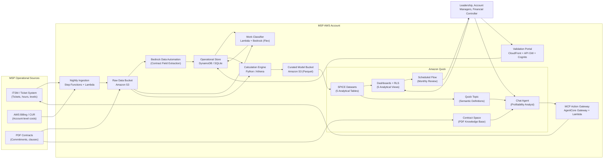
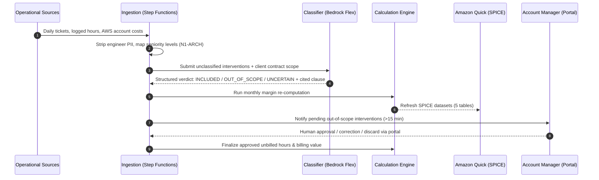

# High-Level Design (HLD) — Marge

**Project:** Marge — Customer-Level Profitability for Managed Service Providers (MSPs)  
**Track:** Track 1 — Run Your MSP Better (Targeting *Best Amazon Quick Application*)  
**Version:** 1.0 — November 11, 2026  
**Language:** English (Submission Deliverable)

---

## 1. Context and Problem Statement

Managed Service Providers sell fixed-price monthly contracts covering IT infrastructure, cloud estates, and user support. While total company revenue and global margins are easily tracked in accounting tools, almost no MSP knows its exact **margin per customer**.

The three pieces of data required to compute client profitability live in three disconnected silos:
1. **Effort:** labor hours logged inside the ticket/ITSM platform.
2. **Infrastructure:** cloud pass-through and tooling consumption inside billing exports (AWS Cost and Usage Reports / invoicing).
3. **Commitments:** baseline fees, included hour allowances, out-of-scope boundaries, and SLA penalties trapped in PDF contracts.

Because synthesizing these sources by hand requires days of spreadsheet manipulation, reviews are infrequent or skipped. Loss-making clients stay hidden, scope creep goes unbilled, and annual renewals are negotiated blindly at historical rates.

**Marge** solves this problem by uniting tickets, cloud billing, and contract commitments into a dated, fully auditable customer profitability model.

---

## 2. Goals and Non-Goals

### 2.1 Goals
- Calculate exact monthly revenue, cost by nature, gross margin, and margin rate for every MSP client.
- Identify every unbilled hour (out-of-scope work and allowance overages) with exact contract clause citations.
- Generate an automated monthly executive narrative and offer an interactive natural-language profitability analyst.
- Keep calculations strictly deterministic and auditable back to individual ticket worklogs and invoice lines.
- Enforce human validation on all probabilistic AI steps before any figure impacts official margins or billing proposals.
- Protect individual engineer privacy by abstracting labor into seniority levels (N1, N2, N3, ARCHITECT).

### 2.2 Non-Goals
- **No General Ledger or Payroll:** Marge does not run company accounting or store individual employee salaries.
- **No Automated Invoicing:** Marge prepares draft billing proposals; the MSP's existing invoicing tool emits them.
- **No Client Cloud Cost Optimization:** Marge tracks MSP profitability, not client-side FinOps or rightsizing.
- **No Model-Calculated Financials:** LLMs never add, subtract, or derive any currency figure (ENF-IA-01).

---

## 3. Requirements Summary

### 3.1 Functional Requirements (FR)
- **Ingestion & Reference (`EF-SRC-*`, `EF-REF-*`):** Ingest tickets with hours and seniority, monthly AWS billing by account, and PDF contracts. Maintain dated hourly rates by seniority and tooling allocation rules. Propose cross-source client identity mappings with confidence scores; flag unassigned hours without silent spreading.
- **Contracts (`EF-CTR-*`):** Extract 16 standardized fields (Annex B) via Bedrock Data Automation; display extracted fields beside source snippets; require human validation; preserve versioned amendments (`EF-CTR-04`).
- **Work Classification (`EF-CLS-*`):** Classify each ticket intervention as `INCLUDED`, `OUT_OF_SCOPE`, or `UNCERTAIN` citing the governing clause; memorize historical decisions per contract category; route out-of-scope items to Account Managers for confirmation.
- **Calculation Engine (`EF-CAL-*`):** Compute revenues, labor/tooling/AWS costs, margins, margin percentages, and unbilled hour values; flag incomplete data with `ESTIMATE` tags; preserve dated calculation versions.
- **Analytics, Agent & Review (`EF-TDB-*`, `EF-AGT-*`, `EF-REV-*`):** Five Quick dashboards with row-level security (RLS); Quick Topic semantic layer; conversational agent with S3 contract space; 3 MCP tools (`create_renegotiation_task`, `draft_extra_billing_proposal`, `get_margin_breakdown`); scheduled monthly review flow with deterministic SES/Bedrock fallback.
- **Validation Portal & Administration (`EF-VAL-*`, `EF-ADM-*`):** Web portal for human approval of client matches, contract clauses, and out-of-scope classifications; role-based administration of margin thresholds, rates, and coverage indicators.

### 3.2 Non-Functional Requirements (NFR)
- **Confidentiality & Privacy (`ENF-CONF-01..04`):** Hourly costs stored exclusively by seniority level; engineer names stripped at ingestion; RLS restricts Account Managers to assigned clients; AWS reseller discounts hidden from account managers.
- **Security (`ENF-SEC-01`):** Encryption at rest and in transit; strict IAM and Cognito role separation.
- **AI Safety & Determinism (`ENF-IA-01..03`):** Zero model-computed amounts; mandatory human-in-the-loop validation; prompt isolation treating ticket and contract text as untrusted data.
- **Traceability (`ENF-TRA-01`):** Every KPI decomposes into granular source lines.
- **Performance (`ENF-PERF-01`):** Full nightly re-computation in under 30 minutes for 200 clients.
- **Reproducibility & Observability (`ENF-REP-01`, `ENF-OBS-01`):** CDK infrastructure-as-code, Quick asset bundle export, pluggable connectors, end-to-end ingestion monitoring and alarms.

---

## 4. System Architecture

### 4.1 Global Architecture



### 4.2 Nightly Execution Sequence



---

## 5. Component Breakdown

| Component | Technology | Responsibility |
|---|---|---|
| **Ingestion Pipeline** | AWS Step Functions, Lambda, EventBridge | Nightly polling of ITSM exports, billing files, and PDF contracts. Strips engineer PII. |
| **Data Lake** | Amazon S3, AWS Glue, Amazon Athena | Raw landing zone, curated Parquet datasets, partition management. |
| **Contract Extractor** | Amazon Bedrock Data Automation | Custom field plan extracting 16 contract parameters and full scope text. |
| **Work Classifier** | AWS Lambda, Amazon Bedrock (Flex tier) | Semantic matching between ticket descriptions and contract service scopes. |
| **Operational Store** | Amazon DynamoDB (cloud) / SQLite (local) | Audit-logged storage for rate cards, tooling rules, client aliases, and human validation decisions. |
| **Validation Portal** | CloudFront, API Gateway, Lambda, Cognito | Fast, lightweight UI for Controllers and Account Managers to approve AI suggestions. |
| **BI & Analytics** | Amazon Quick (Quick Sight) | SPICE-powered dashboards with row-level security for account managers. |
| **Semantic Layer** | Quick Topic | Business glossary standardizing margin definitions and metric synonyms. |
| **Conversational AI** | Quick Custom Chat Agent, S3 Knowledge Space | Q&A on profitability metrics and contract terms with strict citation rules. |
| **Automation** | Quick Flows / EventBridge fallback | Automated monthly narrative drafted on the 3rd business day and dispatched to leadership. |
| **Action Gateway** | AgentCore Gateway, AWS Lambda (MCP) | Exposes MCP tools (`create_renegotiation_task`, `draft_extra_billing_proposal`) to the agent. |

---

## 6. Data Model

The data architecture separates raw transactional inputs from curated analytical tables.

```
+-----------------------------------------------------------------------------------+
| RAW SOURCES (S3 / Ingestion)                                                      |
| - interventions.csv: ticket_id, customer_ref, occurred_on, category, level, hours  |
| - aws_costs.csv: aws_account_id, month, cost, rebilled_amount, kind                |
| - contracts/*.pdf: signed contract documents                                      |
+-----------------------------------------------------------------------------------+
                                       |
                                       v
+-----------------------------------------------------------------------------------+
| OPERATIONAL REPOSITORY (DynamoDB / SQLite)                                        |
| - clients: client_id, name, account_manager_id, sector, onboarded_on              |
| - matches: client_id, source, source_id, confidence, validated_by, validated_at   |
| - contracts: contract_id, client_id, version, subscription, included_hours, ...    |
| - classifications: intervention_id, class, cited_clause, confidence, human_decision|
| - rates: level, hourly_cost, effective_from                                       |
| - tooling_rules: tool, monthly_cost, basis, client_id                             |
+-----------------------------------------------------------------------------------+
                                       |
                                       v
+-----------------------------------------------------------------------------------+
| ANALYTICAL SPICE DATASETS (Amazon Quick - Annex A)                                |
| 1. marge_client_mois: monthly financial results per client (revenue, cost, margin)|
| 2. effort_client_mois_categorie: hours & cost per client, category, level         |
| 3. heures_non_facturees: validated out-of-scope and excess hours with billing value|
| 4. contrats_actifs: active contract terms, 6-month margin, days until renewal    |
| 5. interventions_a_valider: pending classifications awaiting human review         |
+-----------------------------------------------------------------------------------+
```

---

## 7. Deterministic Calculation Model

All financial and hour calculations are implemented in pure Python (`src/marge/calc/`) and Athena SQL. **The LLM never computes or adjusts a number** (ENF-IA-01). Golden test case: Annex D of the spec — revenue 4 620 €, cost 3 725 €, margin 895 € = 19.4 %, 9 unbilled hours × 110 € = 990 € (reproduced exactly by `tests/unit/calc/test_golden_annex_d.py`).

### 7.1 Revenue of a client for a month

Revenue = managed-services subscription + AWS resale margin + billed extra hours + billed projects.

| Component | Definition | Source |
|---|---|---|
| Subscription | Fixed monthly fee | Validated contract |
| AWS resale margin | Amount re-billed to the client − MSP's own AWS cost for its accounts | Billing export + invoices |
| Billed extra hours | Out-of-allowance hours already invoiced | Invoices, or manual entry |
| Billed projects | Project work invoiced in the period | Invoices, or manual entry |

### 7.2 Cost of a client for a month

Cost = labour + tooling + MSP-borne AWS + penalties.

| Component | Formula |
|---|---|
| Labour | Sum over levels of (hours at level × loaded hourly cost of that level in force that month) |
| Tooling | Monthly tool cost (monitoring, backup, licences) allocated per rule: `PER_CLIENT`, `PER_ACCOUNT`, `PER_MANAGED_RESOURCE`, `PER_LABOUR_HOUR` |
| MSP-borne AWS | Cost of MSP tooling accounts dedicated to this client |
| Penalties | SLA penalty credits paid |

### 7.3 Results

| Result | Formula |
|---|---|
| Margin | Revenue − Cost |
| Margin rate | Margin ÷ Revenue |
| Out-of-allowance hours | max(0, consumed included hours − contract allowance) |
| Unbilled hours | validated out-of-scope hours + out-of-allowance hours − billed extra hours |
| Unbilled value | unbilled hours × contract extra-hour rate |
| Service cost per ticket | labour cost ÷ ticket count |

### 7.4 Integrity Safeguards (spec 12.4)
- **Unassigned hours:** work with no attached client goes to an explicit `UNASSIGNED` bucket, displayed separately. It is never silently spread across clients.
- **Incomplete status:** a client without a validated contract shows margin as `INCOMPLETE`.
- **Estimation flag:** a month whose data coverage is below 80 % is marked `ESTIMATE`.
- **Temporal rate consistency:** hourly costs are effective-dated; recomputing a past month always uses the rate in force that month.

---

## 8. The Three AI Steps: Roles, Boundaries, and Safeguards

Marge applies AI strictly where deterministic rules are inadequate. Each step is governed by explicit human validation.

| AI Step | Technology | Role of the Model | Human Validation Gate | Safeguards & Fallbacks |
|---|---|---|---|---|
| **1. Client Matching** | Embedding + LLM matcher | Proposes cross-source client identity links (ITSM vs Billing vs Contract) with a confidence score. | **Financial Controller:** One-click approval on portal. Unvalidated links remain unmerged. | Low-confidence matches (<0.80) require manual entry. Raw source IDs remain logged. |
| **2. Contract Reading** | Bedrock Data Automation | Extracts 16 standardized fields (Annex B) and captures verbatim service boundaries. | **Financial Controller:** Verifies extracted fields side-by-side with source PDF text snippet. | Any unvalidated contract blocks automated margin calculation (`INCOMPLETE` status). |
| **3. Work Classification** | Amazon Bedrock (Flex tier) | Classifies interventions as `INCLUDED`, `OUT_OF_SCOPE`, or `UNCERTAIN` citing contract clauses. | **Account Manager:** Reviews out-of-scope interventions (>15 min) in weekly workflow. | Default to `UNCERTAIN` on ambiguity; sub-15 min filter prevents alert fatigue; past decisions memorized. |

---

## 9. Security, Privacy, and AI Governance

### 9.1 Labor Privacy (`ENF-CONF-01`, `ENF-CONF-02`)
- Individual engineer identifiers (`engineer_ref`) are permanently stripped during the ingestion phase.
- Only labor seniority levels (`N1`, `N2`, `N3`, `ARCHITECT`) are stored and used in calculations.
- Dashboards and exports never display personal timesheets or employee names.

### 9.2 Commercial Confidentiality (`ENF-CONF-03`, `ENF-CONF-04`)
- Quick Row-Level Security (RLS) ensures Account Managers can only query and view data for their assigned accounts.
- Sensitive company-wide rate cards and AWS wholesale partner discounts are restricted to Executive and Financial Controller roles.

### 9.3 AI Safety & Prompt Injection Guardrails (`ENF-IA-01..03`)
- **No LLM Arithmetic:** Financial figures are strictly produced by `marge.calc`.
- **Zero Impact Without Human Review:** AI proposals have zero financial standing until approved by a human.
- **Untrusted Input Isolation:** Ticket descriptions and contract excerpts are treated strictly as passive data, enclosed in delimiter fences (`<ticket_text>` / `<contract_scope>`). The structured JSON parser rejects any output that attempts task deviation.

---

## 10. Observability, Performance, and Reproducibility

### 10.1 Observability (`ENF-OBS-01`)
- Ingestion pipelines emit structured CloudWatch Metrics for every run: raw records ingested, PII stripping rate, unassigned hour counts, classification agreement rate, and pipeline execution time.
- CloudWatch Alarms notify administrators via SNS if ingestion fails or if data coverage drops below the 80% threshold.

### 10.2 Performance (`ENF-PERF-01`)
- The nightly recalculation workflow processes 200 clients, 10,000 monthly tickets, and associated cloud billing records in under **30 minutes**.
- Bedrock classification utilizes the asynchronous Flex tier for nightly batch workloads to maximize cost efficiency without impacting latency.
- Analytical queries leverage SPICE in-memory acceleration, delivering sub-second dashboard rendering and agent lookups.

### 10.3 Reproducibility (`ENF-REP-01`)
- Infrastructure is fully provisioned using AWS CDK (TypeScript/Python).
- Quick assets (dashboards, datasets, topics, RLS rules, flows) are exported as a portable JSON asset bundle (`infra/quicksight-assets/`).
- Connector interfaces are strictly abstracted via standard Python Protocols (`TicketSource`, `BillingSource`, `Store`), allowing any MSP to adapt Marge to Jira, ConnectWise, Datadog, or HaloPSA.

---

## 11. Risks and Mitigations

| Risk | Likelihood | Impact | Architectural Mitigation |
|---|---|---|---|
| **Quick post-trial cost overrun** | Certain | Medium | Start 30-day trial on Nov 23; design for ~330 $ hackathon window; share Quick account with companion initiatives. |
| **Incomplete time-tracking by engineers** | High | High | Prominent data coverage KPI on every dashboard; automatic `ESTIMATE` tags; zero silent spreading. |
| **False out-of-scope accusation harms client trust** | Medium | High | Mandatory Account Manager validation; mandatory clause citation; draft-only billing proposals. |
| **Agent hallucination in conversational responses** | Medium | High | Strict Quick Topic semantic binding; 20-question reference test suite; direct dashboard deep links for verification. |
| **Employee backlash over perceived surveillance** | Medium | High | Hardcoded anonymity: names dropped on ingest; rates and effort tracked exclusively by level. |
| **Contract ambiguity causes classification failure** | Medium | Medium | Model defaults to `UNCERTAIN`; human resolution is memorized in `DecisionMemory` for future tickets. |
| **Manual Quick UI elements (Flows, Agents, Spaces)** | High | Low | Comprehensive step-by-step Runbook documenting exact labels, prompts, and settings. |

---

## 12. Roadmap

- **Phase 1 (Hackathon Delivery):** 12 demo clients, 6-month historical dataset, synthetic PDF contracts, 5 Quick dashboards, Quick Topic, MCP action server, scheduled review flow, validation portal.
- **Phase 2 (Q1 2027):** Native API connectors for ConnectWise Manage, Autotask, HaloPSA, and AWS CUR v2. Invoicing software integration (Stripe, QuickBooks).
- **Phase 3 (Q2 2027):** 3-month predictive margin forecasting using Amazon SageMaker / Bedrock time-series models. Automated contract quoting assistant based on historical peer effort.
