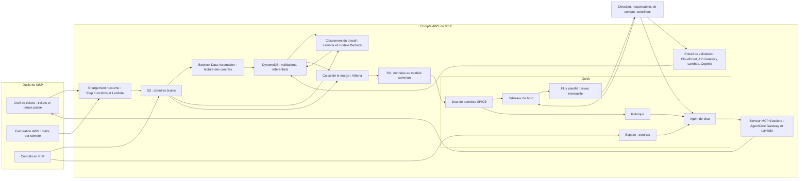
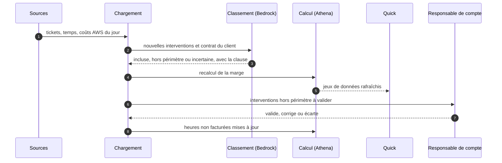

# Cahier des charges — Rentabilité par client

**Nom de travail : Marge** (à changer librement)
Version 1.0 du 11 novembre 2026 — Hackathon AWS MSP AI, Track 1

> Ce document est en français pour le travail interne. Tous les livrables de la soumission (description, vidéo, schéma d'architecture, document de conception) doivent être en anglais.
>
> Les faits marqués **(vérifié)** ont été lus dans la documentation et les pages de tarifs AWS le 11 novembre 2026 (sources en annexe F). Tout ce qui reste à confirmer est regroupé au chapitre 24.
>
> La documentation écrit « AWS Quick », les pages commerciales « Amazon Quick ». C'est le même service. Ce document écrit « Quick ».

---

## 1. Fiche d'identité

| Élément | Valeur |
|---|---|
| Track | 1 — Run Your MSP Better |
| Objet | Opérations internes du MSP : pilotage financier de son activité de services managés |
| Prix spécial visé | Best Amazon Quick Application |
| Services IA AWS | Quick (Quick Sight, rubrique, agent de chat, Flows, espaces, scénarios, intégration MCP), Amazon Bedrock (Data Automation pour lire les contrats, modèle pour classer le travail), AgentCore Gateway (outils de l'agent) |
| Utilisateurs | Direction du MSP, responsables de compte, direction des opérations, finance |
| Échéance de soumission | Vendredi 11 décembre 2026, 12h00 PT (21h00 à Paris) |
| Fin du jugement | 22 janvier 2027 : la solution doit rester en ligne jusque-là |

## 2. Résumé

Un MSP vend des contrats de services managés à prix fixe. L'effort réel, lui, varie beaucoup d'un client à l'autre. Presque aucun MSP ne connaît sa marge par client, parce que les trois données nécessaires vivent dans trois outils : le temps passé dans l'outil de tickets, la facture AWS dans la console de facturation, les engagements dans des contrats en PDF.

Marge croise ces trois sources. Il donne à la direction :

1. **La marge de chaque client**, chaque mois, avec ce qui l'explique.
2. **Les heures travaillées mais non facturées** : le travail hors périmètre et les dépassements de forfait que personne n'a relevés.
3. **Une revue mensuelle rédigée** et un agent à qui poser des questions avant un renouvellement.

L'IA intervient à trois endroits où une règle fixe ne suffit pas : lire les contrats, dire si un travail entrait dans le périmètre du contrat, et répondre en langage naturel sur les chiffres. Les calculs de marge, eux, sont faits par du code.

## 3. Contexte et problème

### 3.1 Le problème du MSP

- **Marge inconnue par client :** la marge globale est connue, pas sa répartition.
- **Clients déficitaires invisibles :** quelques clients consomment une grande part des heures pour un abonnement moyen.
- **Travail offert sans le savoir :** un ingénieur traite une demande hors contrat parce que c'est plus rapide que de chercher si elle est incluse.
- **Renouvellements à l'aveugle :** le prix est reconduit sans regarder ce que le client a coûté.
- **Revue pénible :** produire le chiffre demande des jours d'exports et de tableur, donc on ne le fait pas.

### 3.2 Ce que Quick fournit (vérifié)

| Capacité | Usage dans Marge |
|---|---|
| Quick Sight | Jeux de données, tableaux de bord, filtrage par ligne |
| Rubriques | Couche sémantique : définitions de la marge, de l'effort, des heures non facturées |
| Chat et agents personnalisés | Agent « analyste de rentabilité » relié à la rubrique et aux contrats |
| Espaces et bases de connaissances | Les contrats, depuis S3, consultables par l'agent |
| Scénarios | Simulations : hausse de prix, baisse d'effort |
| Quick Flows planifiés | Revue mensuelle rédigée et envoyée |
| Intégration MCP | Actions de l'agent vers l'outil de tickets du MSP (abonnement Enterprise requis) |
| Création de documents | Passage d'une conversation à un document |

### 3.3 Ce que Quick ne fait pas seul

| Manque | Réponse de Marge |
|---|---|
| Les données ne sont pas réunies | Chaîne qui charge tickets, temps, factures et contrats dans un modèle commun |
| Les clients n'ont pas le même nom dans chaque outil | Table de correspondance proposée par un modèle, validée par un humain |
| Les contrats sont des PDF | Extraction des clauses utiles avec Bedrock Data Automation, validée par un humain |
| Rien ne dit si un travail était dans le contrat | Classement de chaque intervention au regard du périmètre, avec la clause citée |
| La marge par client n'existe nulle part | Modèle de calcul écrit, daté, identique pour tous les clients |

## 4. Objectifs et indicateurs

### 4.1 Indicateurs du projet

| Indicateur | Définition | Situation de départ | Cible démo | Cible production |
|---|---|---|---|---|
| Marge par client | Revenus moins coûts, par client et par mois (chapitre 12) | Inconnue | Affichée pour 12 clients fictifs sur 6 mois | Affichée pour 100 % des clients, à jour chaque mois |
| Heures non facturées repérées | Heures hors périmètre ou au-delà du forfait, non facturées, validées par un humain | Inconnues | Repérées sur les cas semés | Suivies chaque mois, en heures et en valeur |
| Temps de préparation de la revue | Du lancement à la revue prête | Plusieurs jours (hypothèse à valider) | Moins de 10 minutes | Moins de 1 heure, validations comprises |
| Couverture des données | Heures rattachées à un client et à un contrat, divisées par les heures saisies | Non mesurée | Plus de 95 % | Plus de 90 % |
| Clauses extraites sans correction | Champs de contrat acceptés tels quels | — | Plus de 90 % | Plus de 95 % |
| Classement du travail | Accord avec un humain sur un jeu étiqueté | — | Plus de 90 % | Plus de 92 % |
| Exactitude de l'agent | Réponses justes sur un jeu de questions de référence | — | Plus de 90 % sur 20 questions | Plus de 95 % |

### 4.2 Gains d'efficacité visés

Le Track 1 demande des gains mesurables. Ceux-ci sont à chiffrer dans la soumission à partir des données de démonstration :

- **Temps :** la revue mensuelle passe de plusieurs jours de tableur à quelques minutes.
- **Revenu récupéré :** valeur des heures non facturées repérées, en heures multipliées par le tarif du contrat.
- **Décision :** nombre de clients sous le seuil de marge repérés avant leur renouvellement.

Tous les montants sont calculés par le code. Le modèle de langage n'en calcule aucun.

## 5. Périmètre

### 5.1 Inclus dans la version du hackathon

- Un MSP fictif, 12 clients, 6 mois d'historique généré.
- Trois sources : export de tickets avec temps passé, données de facturation AWS par compte, 12 contrats en PDF.
- Table de correspondance des clients entre les sources.
- Extraction des clauses des contrats, avec validation.
- Classement des interventions : incluse, hors périmètre, incertaine.
- Calcul de la marge par client et par mois.
- Cinq tableaux de bord, une rubrique, un agent de chat.
- Revue mensuelle par flux planifié.
- Deux actions de l'agent : créer une tâche de renégociation, préparer une proposition de facturation complémentaire.
- Portail de validation.

### 5.2 Cible après le hackathon

- Connecteurs vers les outils de tickets et de gestion de services du marché.
- Factures émises aux clients, depuis l'outil de facturation.
- Projets au forfait et en régie.
- Prévision de la marge à 3 mois.
- Aide au chiffrage des nouveaux contrats à partir des clients comparables.

### 5.3 Exclu

- Comptabilité générale et clôture.
- Paie et données individuelles des salariés.
- Facturation elle-même : Marge prépare, l'outil de facturation émet.
- Optimisation des coûts AWS des clients.

## 6. Utilisateurs et rôles

| Rôle | Ce qu'il fait | Ce qu'il voit | Licence Quick |
|---|---|---|---|
| Dirigeant | Lit la revue, décide des renégociations | Tous les clients | Professional |
| Directeur des opérations | Analyse l'effort par client et par type de travail | Tous les clients | Professional |
| Responsable de compte | Prépare ses renouvellements, valide les heures hors périmètre | Ses clients | Professional, avec filtrage par ligne |
| Contrôleur de gestion | Tient les référentiels de coûts, valide les clauses extraites | Tous les clients, coûts par niveau | Enterprise |
| Administrateur | Branche les sources, maintient les tableaux de bord | Technique | Enterprise |

Les coûts horaires sont tenus par niveau (N1, N2, N3, architecte), jamais par personne. Aucun tableau de bord ne montre le temps d'un salarié nommé.

## 7. Offre et reproductibilité

Ce projet est d'abord un outil interne. Le critère « reproductible chez d'autres partenaires » est traité ainsi :

- **Connecteurs abstraits :** une interface par type de source. Un autre MSP branche son propre outil de tickets en écrivant un adaptateur.
- **Modèle de calcul paramétré :** niveaux, coûts horaires, règles d'allocation de l'outillage sont des tables de réglage.
- **Actifs Quick exportés :** tableaux de bord, jeux de données et rubrique livrés en lot d'actifs.
- **Installation en code :** un README, une commande.

Un MSP validé pourrait aussi le proposer à d'autres partenaires comme offre packagée. Ce n'est pas l'objet de la soumission.

## 8. Parcours

### 8.1 Installation

1. L'administrateur branche les trois sources et lance le premier chargement.
2. Un modèle propose la correspondance des clients entre les sources (« ACME SAS », « Acme », compte AWS 1234). Le contrôleur valide.
3. Les contrats sont lus. Le contrôleur valide les clauses extraites, contrat par contrat.
4. Le contrôleur saisit les coûts horaires par niveau et les règles d'allocation de l'outillage.

### 8.2 Chaque nuit

1. Les nouveaux tickets, temps et coûts AWS sont chargés.
2. Chaque intervention est classée au regard du contrat du client.
3. La marge est recalculée. Les jeux de données Quick sont rafraîchis.

### 8.3 Chaque semaine

Le responsable de compte reçoit la liste des interventions classées « hors périmètre » chez ses clients. Il valide, corrige ou écarte chacune. Seules les heures validées comptent comme « non facturées repérées ».

### 8.4 Chaque mois

1. Le flux planifié lit les tableaux de bord et rédige la revue : marge globale, clients sous le seuil, plus fortes variations, heures non facturées, renouvellements à 90 jours.
2. La revue est envoyée à la direction et rangée dans l'espace du projet.

### 8.5 Avant un renouvellement

1. Le responsable de compte interroge l'agent : « Que nous a coûté ce client sur 6 mois, et pourquoi ? ».
2. Il simule : « Et avec 8 % de hausse ? Et si le volume de tickets baisse de 20 % ? ».
3. Il demande à l'agent de créer la tâche de renégociation, avec le dossier chiffré joint.

## 9. Exigences fonctionnelles

Priorité : **M** indispensable pour la démonstration, **S** souhaitable, **C** cible après le hackathon.

### 9.1 Sources et référentiels

| Réf. | Priorité | Exigence |
|---|---|---|
| EF-SRC-01 | M | Charger les tickets et le temps passé : client, type, catégorie, dates, intervenant, niveau, durée, description. |
| EF-SRC-02 | M | Charger les coûts AWS par compte et par mois, depuis un export de facturation. |
| EF-SRC-03 | M | Charger les contrats en PDF depuis un compartiment S3. |
| EF-SRC-04 | S | Charger les factures émises aux clients. |
| EF-SRC-05 | C | Connecteurs directs vers les outils du marché. |
| EF-REF-01 | M | Proposer la correspondance des clients entre les sources, avec un niveau de confiance. Validation humaine obligatoire. |
| EF-REF-02 | M | Tenir les coûts horaires chargés par niveau, datés. |
| EF-REF-03 | M | Tenir les règles d'allocation de l'outillage : par client, par compte ou par ressource gérée. |
| EF-REF-04 | M | Signaler les heures et les coûts non rattachés à un client. |

### 9.2 Contrats

| Réf. | Priorité | Exigence |
|---|---|---|
| EF-CTR-01 | M | Extraire de chaque contrat les champs de l'annexe B avec Bedrock Data Automation. |
| EF-CTR-02 | M | Présenter chaque champ extrait à côté du passage du contrat dont il vient. |
| EF-CTR-03 | M | Faire valider chaque contrat par le contrôleur. Un contrat non validé n'entre pas dans le calcul. |
| EF-CTR-04 | M | Garder l'historique : un avenant crée une nouvelle version datée. |
| EF-CTR-05 | S | Alerter sur une échéance de renouvellement à 90 jours. |

### 9.3 Classement du travail

| Réf. | Priorité | Exigence |
|---|---|---|
| EF-CLS-01 | M | Classer chaque intervention : incluse, hors périmètre, incertaine. |
| EF-CLS-02 | M | Justifier chaque classement « hors périmètre » par la clause du contrat qui délimite le périmètre. |
| EF-CLS-03 | M | Soumettre les classements « hors périmètre » et « incertaine » au responsable de compte. |
| EF-CLS-04 | M | Réutiliser les décisions passées : une catégorie de travail déjà tranchée pour un contrat ne redemande pas de validation. |
| EF-CLS-05 | S | Repérer le dépassement du forfait d'heures incluses. |

### 9.4 Calcul

| Réf. | Priorité | Exigence |
|---|---|---|
| EF-CAL-01 | M | Calculer par client et par mois : revenus, coûts par nature, marge, taux de marge (chapitre 12). |
| EF-CAL-02 | M | Calculer les heures incluses, consommées, hors périmètre, et les heures non facturées avec leur valeur. |
| EF-CAL-03 | M | Garder chaque version du calcul : un changement de coût horaire ou de règle ne réécrit pas le passé sans trace. |
| EF-CAL-04 | M | Marquer comme estimation toute valeur issue d'une donnée incomplète. |
| EF-CAL-05 | S | Calculer l'effort par ticket, par catégorie et par ressource gérée. |

### 9.5 Tableaux de bord, agent, revue

| Réf. | Priorité | Exigence |
|---|---|---|
| EF-TDB-01 | M | Vue d'ensemble : marge totale, classement des clients, clients sous le seuil, tendance. |
| EF-TDB-02 | M | Fiche client : revenus, coûts par nature, heures par niveau et par catégorie, forfait, contrat. |
| EF-TDB-03 | M | Heures non facturées : par client, en heures et en valeur, avec leur état. |
| EF-TDB-04 | M | Renouvellements à 90 jours, avec marge et tendance. |
| EF-TDB-05 | S | Effort : types de travail qui coûtent le plus, par client. |
| EF-TDB-06 | M | Filtrage par ligne : un responsable de compte ne voit que ses clients. |
| EF-AGT-01 | M | Agent de chat relié à la rubrique et à l'espace des contrats. |
| EF-AGT-02 | M | Chaque réponse chiffrée donne la période, le client et le lien vers le tableau de bord. |
| EF-AGT-03 | M | Une réponse sur un contrat cite la clause. |
| EF-AGT-04 | M | Deux actions par un serveur MCP : créer une tâche de renégociation, préparer une proposition de facturation complémentaire. |
| EF-AGT-05 | S | Scénarios : effet d'une hausse de prix ou d'une baisse d'effort sur la marge. |
| EF-REV-01 | M | Revue mensuelle par flux planifié, selon la trame de l'annexe E. |
| EF-REV-02 | M | Envoi à la direction, dépôt dans l'espace du projet. |
| EF-REV-03 | S | Repli : revue produite par une fonction à partir des agrégats, si le flux planifié ne convient pas. |

### 9.6 Validation et administration

| Réf. | Priorité | Exigence |
|---|---|---|
| EF-VAL-01 | M | Portail de validation : correspondance des clients, clauses des contrats, classements du travail. |
| EF-VAL-02 | M | Chaque validation garde son auteur, sa date et son motif. |
| EF-ADM-01 | M | Réglages : seuil de marge, niveaux, coûts horaires, règles d'allocation, seuil de confiance. |
| EF-ADM-02 | M | Indicateur de couverture des données, visible sur chaque tableau de bord. |
| EF-ADM-03 | M | Identifiants de démonstration pour les juges, côté portail et côté Quick. |

## 10. Exigences non fonctionnelles

| Réf. | Exigence |
|---|---|
| ENF-CONF-01 | Les coûts horaires sont tenus par niveau. Aucune donnée de paie individuelle n'entre dans le système. |
| ENF-CONF-02 | Aucun tableau de bord ne montre le temps d'un salarié nommé. |
| ENF-CONF-03 | Filtrage par ligne par responsable de compte. Les coûts horaires ne sont visibles que du contrôleur et de la direction. |
| ENF-CONF-04 | Les remises accordées par AWS au MSP restent hors des données montrées aux responsables de compte. |
| ENF-SEC-01 | Chiffrement au repos et en transit. Accès par rôles. |
| ENF-IA-01 | Aucun montant calculé par le modèle. |
| ENF-IA-02 | Aucune clause extraite et aucun classement « hors périmètre » ne comptent sans validation humaine. |
| ENF-IA-03 | Le texte des tickets et des contrats est une donnée, jamais une instruction. |
| ENF-TRA-01 | Chaque chiffre affiché se décompose jusqu'aux lignes sources. |
| ENF-PERF-01 | Recalcul nocturne complet en moins de 30 minutes pour 200 clients. |
| ENF-REP-01 | Infrastructure en code, actifs Quick en lot, connecteurs remplaçables. |
| ENF-OBS-01 | Supervision de chaque chargement, alarmes sur les échecs. |

## 11. Architecture technique

### 11.1 Vue d'ensemble



### 11.2 Composants

| Composant | Service AWS | Rôle |
|---|---|---|
| Chargement | Step Functions, Lambda, EventBridge Scheduler | Lit les sources chaque nuit |
| Lac de données | S3, Glue Data Catalog, Athena | Données brutes, données au modèle commun, calcul |
| Lecture des contrats | Bedrock Data Automation | Extraction des clauses selon un plan de champs |
| Classement du travail | Lambda, Amazon Bedrock | Classe chaque intervention, en sortie structurée, niveau Flex pour le traitement nocturne |
| Validation | CloudFront, S3, API Gateway, Lambda, Cognito, DynamoDB | Portail du contrôleur et des responsables de compte |
| Analytique | Quick Sight | Jeux de données, tableaux de bord, rubrique, filtrage par ligne |
| Conversation | Agent de chat de Quick, espace des contrats | Questions sur les chiffres et sur les contrats |
| Automatisation | Quick Flows | Revue mensuelle |
| Actions | AgentCore Gateway, Lambda | Serveur MCP vers l'outil de tickets |
| Infrastructure en code | AWS CDK, lot d'actifs Quick Sight | Reproductibilité |

### 11.3 Où l'IA intervient, et où elle n'intervient pas

| Étape | Qui décide | Contrôle |
|---|---|---|
| Correspondance des clients | Le modèle propose | Le contrôleur valide |
| Clauses des contrats | Bedrock Data Automation extrait | Le contrôleur valide, passage source affiché |
| Classement du travail | Le modèle propose, avec la clause | Le responsable de compte valide les « hors périmètre » |
| Calcul de la marge | Le code | Tests, décomposition jusqu'aux lignes |
| Réponses de l'agent | Quick, sur la rubrique | Jeu de questions de référence |
| Revue mensuelle | Le flux rédige | Les chiffres viennent des tableaux de bord |

### 11.4 Déroulé nocturne



## 12. Modèle de calcul

### 12.1 Revenus d'un client pour un mois

| Poste | Source |
|---|---|
| Abonnement de services managés | Contrat validé |
| Marge de revente AWS | Montant refacturé au client moins coût AWS du MSP pour ses comptes |
| Heures hors forfait facturées | Factures émises, ou saisie |
| Projets facturés | Factures émises, ou saisie |

### 12.2 Coûts d'un client pour un mois

| Poste | Calcul |
|---|---|
| Travail | Somme des heures par niveau, multipliées par le coût horaire chargé du niveau |
| Outillage | Coût mensuel des outils (supervision, sauvegarde, licences), réparti selon la règle d'allocation |
| AWS à la charge du MSP | Coûts des comptes d'outillage dédiés à ce client |
| Pénalités | Pénalités de niveau de service versées |

### 12.3 Résultats

| Résultat | Formule |
|---|---|
| Marge | Revenus moins coûts |
| Taux de marge | Marge divisée par les revenus |
| Heures hors forfait | Maximum de zéro et de (heures incluses consommées moins forfait du contrat) |
| Heures non facturées | Heures hors périmètre validées, plus heures hors forfait, moins heures hors forfait facturées |
| Valeur des heures non facturées | Heures non facturées multipliées par le tarif horaire du contrat |
| Coût de service par ticket | Coût du travail divisé par le nombre de tickets |

### 12.4 Règles

- Une heure sans client rattaché va dans « non affecté », affiché à part. Elle n'est jamais répartie en silence.
- Un client sans contrat validé a une marge affichée « incomplète ».
- Un mois dont la couverture des données est sous 80 % est marqué comme estimation.
- Les coûts horaires sont datés : le calcul d'un mois passé utilise le coût en vigueur ce mois-là.

## 13. Lecture des contrats et classement du travail

### 13.1 Lecture des contrats

- **Moyen :** Bedrock Data Automation, avec un plan de champs personnalisé **(vérifié : sortie personnalisée par plan de champs pour les documents)**.
- **Champs :** annexe B.
- **Contrôle :** chaque champ est montré à côté de son passage source. Le contrôleur valide en un clic ou corrige.
- **Périmètre du contrat :** la liste des services inclus et exclus est extraite en texte et conservée entière. C'est elle qui sert au classement.

### 13.2 Classement d'une intervention

- **Entrée :** la description du ticket, sa catégorie, le temps passé, et le périmètre du contrat du client.
- **Sortie structurée :** annexe C.
- **Règle de prudence :** en cas de doute, le classement est « incertaine », jamais « hors périmètre ».
- **Seuil :** une intervention hors périmètre de moins de 15 minutes est comptée mais non soumise à validation, pour ne pas noyer le responsable de compte. Le seuil est réglable.
- **Mémoire des décisions :** une décision humaine sur une catégorie de travail pour un contrat s'applique aux interventions suivantes de la même catégorie.
- **Coût :** traitement nocturne au niveau Flex de Bedrock, qui offre une remise pour les traitements tolérant un délai **(vérifié)**.

### 13.3 Mesure

| Élément | Jeu de test | Cible |
|---|---|---|
| Clauses de contrat | 12 contrats, valeurs attendues saisies à la main | Plus de 90 % des champs justes |
| Classement | 150 interventions étiquetées | Plus de 90 % d'accord ; aucun « hors périmètre » sur une intervention clairement incluse |
| Correspondance des clients | 12 clients, 3 sources | 100 % après validation, plus de 80 % proposés juste |

## 14. Rubrique, agent et revue

### 14.1 Rubrique

Elle porte les définitions du chapitre 12, les synonymes (« rentabilité », « marge », « ce que le client rapporte ») et les agrégations par défaut. Toute question sur la marge passe par elle, pour que deux personnes obtiennent le même chiffre.

### 14.2 Agent « analyste de rentabilité »

- **Consignes :** répondre à partir de la rubrique et des contrats, citer la période et le client, donner le lien du tableau de bord, citer la clause quand il parle d'un contrat, dire quand une valeur est une estimation, ne jamais estimer un chiffre lui-même.
- **Connaissances :** la rubrique ; l'espace des contrats.
- **Actions :** par le serveur MCP.

### 14.3 Actions MCP

| Outil | Effet | Garde-fou |
|---|---|---|
| `create_renegotiation_task` | Crée une tâche pour le responsable de compte dans l'outil de tickets, avec le dossier chiffré | Un seul dossier ouvert par client |
| `draft_extra_billing_proposal` | Prépare une proposition de facturation complémentaire à partir des heures validées | Brouillon uniquement ; rien n'est envoyé au client |
| `get_margin_breakdown` | Renvoie la décomposition d'une marge jusqu'aux postes | Lecture seule, selon les droits de l'appelant |

### 14.4 Revue mensuelle

- **Flux :** lecture des tableaux de bord et de la rubrique, raisonnement, rédaction, envoi.
- **Planification :** mensuelle, le troisième jour ouvré.
- **Propriétaire :** une planification appartient à l'utilisateur qui la crée **(vérifié)**. Elle est créée par le contrôleur.
- **Repli :** une fonction produit la revue à partir des agrégats avec Amazon Bedrock et l'envoie par SES.

### 14.5 Exemples de questions

- « Quels clients sont sous 20 % de marge ce trimestre ? »
- « Pourquoi la marge du client Durand a-t-elle baissé en octobre ? »
- « Combien d'heures hors périmètre avons-nous faites pour le client Leroy, et sur quels sujets ? »
- « Le contrat du client Martin inclut-il les mises à jour de version de base de données ? »
- « Quels contrats se renouvellent dans les 90 jours avec une marge en baisse ? »

## 15. Modèle de données

| Table | Champs principaux |
|---|---|
| `clients` | identifiant commun, nom, responsable de compte, secteur, date d'entrée |
| `correspondances` | identifiant commun, source, identifiant dans la source, confiance, validateur |
| `contrats` | identifiant, client, version, début, fin, reconduction, préavis, abonnement mensuel, heures incluses, tarif horaire hors forfait, périmètre inclus, exclusions, pénalités, état de validation |
| `interventions` | identifiant, ticket, client, date, catégorie, niveau de l'intervenant, durée, description |
| `classements` | intervention, classe, clause citée, confiance, décision humaine, auteur, date |
| `couts_aws` | client, compte, mois, coût, montant refacturé |
| `couts_horaires` | niveau, coût horaire chargé, date d'effet |
| `outillage` | outil, coût mensuel, règle d'allocation |
| `marge_mensuelle` | client, mois, revenus par poste, coûts par poste, marge, taux, couverture des données, version du calcul |
| `heures_non_facturees` | client, mois, heures hors périmètre validées, heures hors forfait, heures facturées, valeur, état |

Le détail des tables analytiques est en annexe A.

## 16. API du portail de validation

| Méthode et chemin | Objet |
|---|---|
| `GET /v1/matches`, `POST /v1/matches/{id}/decision` | Correspondance des clients |
| `GET /v1/contracts`, `GET /v1/contracts/{id}`, `PUT /v1/contracts/{id}/fields`, `POST /v1/contracts/{id}/validate` | Contrats et clauses |
| `GET /v1/classifications?status=pending`, `POST /v1/classifications/{id}/decision` | Classements à valider |
| `GET /v1/rates`, `PUT /v1/rates` | Coûts horaires par niveau |
| `GET /v1/allocation-rules`, `PUT /v1/allocation-rules` | Règles d'allocation de l'outillage |
| `GET /v1/coverage` | Couverture des données |
| `POST /v1/recalculate` | Recalcul à la demande |

## 17. Sécurité et confidentialité

- **Données sociales :** le système ne reçoit que des durées et des niveaux. Les noms des intervenants sont remplacés par leur niveau au chargement.
- **Données commerciales :** contrats et marges sont réservés à la direction, au contrôleur et, pour ses clients, au responsable de compte.
- **Données des clients :** les descriptions de tickets peuvent contenir des informations sur les clients. Elles restent dans le compte du MSP et ne sont envoyées qu'à un modèle Bedrock de la même région.
- **Journal :** chaque validation, chaque changement de coût horaire et chaque recalcul sont tracés.
- **Console d'administration de Quick :** seules les permissions IAM s'y appliquent **(vérifié)**. Son accès est réservé à l'administrateur.

## 18. Coûts et budget

### 18.1 Tarifs Quick (vérifié)

| Poste | Tarif |
|---|---|
| Offre Professional | 20 $ par utilisateur et par mois |
| Offre Enterprise | 40 $ par utilisateur et par mois |
| Frais d'infrastructure | 250 $ par compte et par mois |
| Heures d'agent incluses | 8 par mois (Professional), 18 par mois (Enterprise) |
| SPICE | 0,38 $ par Go et par mois |
| Essai gratuit | 30 jours, jusqu'à 25 utilisateurs, abonnements et frais d'infrastructure offerts |

### 18.2 En production, pour un MSP de 50 clients (estimation)

| Poste | Coût mensuel |
|---|---|
| Frais d'infrastructure Quick | 250 $ |
| 1 licence Enterprise et 6 licences Professional | 160 $ |
| Lecture des contrats et classement du travail | Quelques dizaines de dollars, selon le volume de tickets |
| Stockage et calcul | Quelques dollars |
| **Total** | **Environ 450 $** |

Ce coût est à comparer à la valeur d'une seule heure non facturée retrouvée par client et par mois.

### 18.3 Pour le hackathon

| Période | Coût Quick | Remarque |
|---|---|---|
| Avant l'essai | 0 $ | Chargement, contrats, classement, calcul et portail se construisent sans Quick |
| 30 jours d'essai | 0 $ | À démarrer le 23 novembre : l'essai court jusqu'au 23 décembre |
| Du 23 décembre au 22 janvier | Environ 330 $ | 250 $ de frais, 1 licence Enterprise, 2 licences Professional |

- Les 200 $ de crédits expirent le 31 décembre 2026.
- Si tu réalises aussi « Analytique IA par abonnement », les deux projets peuvent partager le même compte Quick.

## 19. Plan de démonstration

### 19.1 Environnement

- **Un MSP fictif**, 12 clients, 6 mois de tickets, de temps passé et de coûts AWS générés.
- **12 contrats en PDF**, rédigés pour l'occasion, de formes différentes.
- **Situations semées :**
  - deux clients déficitaires, dont l'un par un volume de tickets anormal ;
  - trois clients avec du travail hors périmètre répété ;
  - un client rentable dont le contrat se renouvelle dans 60 jours avec une marge en baisse ;
  - un contrat dont une clause est ambiguë.
- Aucune donnée réelle.

### 19.2 Vidéo de 3 minutes

| Temps | Contenu |
|---|---|
| 0:00 à 0:20 | Le problème : trois outils, aucune marge par client, des heures offertes sans le savoir. |
| 0:20 à 0:50 | Portail : un contrat lu, ses clauses à côté du texte source, validation en un clic. La correspondance des clients proposée. |
| 0:50 à 1:25 | Tableau de bord : classement des clients par marge, deux clients dans le rouge. Fiche d'un client : d'où vient le coût. |
| 1:25 à 1:55 | Heures non facturées : une intervention classée hors périmètre, la clause citée, la validation du responsable de compte. Le total en heures et en valeur. |
| 1:55 à 2:30 | Agent : « Pourquoi ce client a-t-il perdu dix points de marge ? », puis une simulation de hausse de prix, puis la création de la tâche de renégociation. |
| 2:30 à 2:45 | La revue mensuelle reçue par e-mail. |
| 2:45 à 3:00 | Schéma d'architecture, gains mesurés, installation chez un autre MSP. |

La vidéo doit montrer les comptes internes et les environnements en amont et en aval : sources, lac de données, console Quick, outil de tickets où la tâche est créée.

## 20. Livrables du hackathon et critères de jugement

### 20.1 Liste de contrôle de la soumission

- [ ] Track 1 sélectionné, service IA AWS indiqué.
- [ ] Description en anglais : fonctions, problème, gains d'efficacité mesurés.
- [ ] URL publique du portail ; identifiants de démonstration pour le portail et pour Quick dans les instructions de test.
- [ ] Dépôt privé partagé avec `testing@devpost.com` et `aws-msp@amazon.com`.
- [ ] Le code appelle réellement un service IA AWS à l'exécution (Bedrock Data Automation, modèle Bedrock, API Quick Sight, serveur MCP chargé par l'agent).
- [ ] Vidéo d'environ 3 minutes, publique sur YouTube, en anglais, sans marque ni musique tierce.
- [ ] Schéma d'architecture.
- [ ] Document de conception (HLD).

### 20.2 Réponse aux quatre critères (25 % chacun)

| Critère | Ce que le projet montre |
|---|---|
| Mise en œuvre technique | Quick employé dans sa largeur : tableaux de bord, rubrique, agent, espace, scénarios, flux planifié, actions MCP. Relié à Bedrock Data Automation et à un modèle Bedrock. |
| Conception | Validation humaine à chaque étape incertaine, calcul traçable jusqu'aux lignes, données sociales protégées, connecteurs remplaçables. |
| Impact | Trois chiffres sur les données de démonstration : temps de la revue, valeur des heures non facturées, clients sous le seuil repérés avant renouvellement. |
| Innovation | Un problème propre aux MSP, que les juges connaissent, traité en croisant trois sources que personne ne rapproche. |

## 21. Planning

| Semaine | Dates | Travaux | Résultat attendu |
|---|---|---|---|
| S1 | 11 au 15 novembre | Compte AWS, demande de crédits, générateur de données, 12 contrats, chargement vers S3 et Athena | Tickets, temps et coûts interrogeables |
| S2 | 16 au 22 novembre | Lecture des contrats, correspondance des clients, portail de validation, classement du travail, modèle de calcul | Marge par client calculée, validations faites |
| S3 | 23 au 29 novembre | Début de l'essai Quick. Jeux de données, cinq tableaux de bord, rubrique, filtrage par ligne | Tableaux de bord sur les 12 clients |
| S4 | 30 novembre au 6 décembre | Agent, espace des contrats, serveur MCP, scénarios, revue mensuelle, jeux de test, schéma et HLD en anglais | Parcours complet |
| S5 | 7 au 11 décembre | Recette, tournage, description, instructions de test, partage du dépôt | Soumission le 10 décembre au soir, un jour de marge |

## 22. Risques

| Risque | Probabilité | Impact | Parade |
|---|---|---|---|
| Coût de Quick après l'essai | Certaine | Moyen | Essai démarré le 23 novembre, budget d'environ 330 $ prévu, compte partagé avec l'autre projet Quick. |
| Dans la réalité, le temps passé est mal saisi | Forte | Fort | Indicateur de couverture partout, valeurs marquées comme estimations, jamais de répartition silencieuse. |
| Un classement « hors périmètre » erroné crée un litige avec un client | Moyenne | Fort | Validation humaine obligatoire, clause citée, proposition de facturation en brouillon seulement. |
| L'agent donne un chiffre faux | Moyenne | Fort | Rubrique soignée, jeu de questions de référence, lien vers le tableau de bord, décomposition disponible. |
| Sensibilité sociale : l'outil perçu comme un contrôle des salariés | Moyenne | Fort | Niveaux et non personnes, aucun tableau individuel, règle écrite dans le document de conception. |
| Clause de contrat ambiguë | Moyenne | Moyen | Classement « incertaine », décision humaine mémorisée. |
| Agents, flux et espaces non créables par programme | Forte | Faible | Un seul MSP : création à la main, décrite pas à pas dans le README. |
| Le projet passe pour un simple tableau de bord | Moyenne | Fort | Mettre en avant la lecture des contrats, le classement du travail et les actions de l'agent. |
| Retard sur le planning | Moyenne | Fort | Les exigences S et C sont sacrifiables. Le parcours M prime. |

## 23. Recette

| Réf. | Scénario | Résultat attendu |
|---|---|---|
| R1 | Chargement des trois sources | Couverture des données supérieure à 95 % |
| R2 | Correspondance des clients | Plus de 80 % proposés juste ; 100 % après validation |
| R3 | Lecture de 12 contrats | Plus de 90 % des champs justes ; passage source affiché |
| R4 | Contrat non validé | Marge du client affichée « incomplète » |
| R5 | 150 interventions étiquetées | Plus de 90 % d'accord |
| R6 | Intervention clairement incluse | Jamais classée « hors périmètre » |
| R7 | Validation d'heures hors périmètre | Heures non facturées et valeur mises à jour |
| R8 | Marge d'un client | Se décompose jusqu'aux lignes sources ; total recalculé à la main identique |
| R9 | Changement d'un coût horaire | Mois passés inchangés, nouvelle version datée |
| R10 | Responsable de compte | Ne voit que ses clients, ne voit pas les coûts horaires |
| R11 | 20 questions de référence à l'agent | Plus de 90 % de réponses justes |
| R12 | Question sur une clause | Réponse avec la clause citée |
| R13 | Demande de tâche de renégociation | Tâche créée dans l'outil de tickets, dossier joint |
| R14 | Revue mensuelle | Reçue, chiffres identiques aux tableaux de bord |
| R15 | Installation dans un compte vierge | Réussie en suivant le README |

## 24. Points à confirmer

| N° | Question | Quand |
|---|---|---|
| 1 | Ton organisation est-elle inscrite à l'AWS Partner Network ? | Avant tout |
| 2 | Régions où Quick, ses fonctions d'IA et Bedrock Data Automation sont disponibles ensemble | S1 |
| 3 | Les crédits du hackathon s'appliquent-ils aux abonnements Quick ? | S1 |
| 4 | Bedrock Data Automation rend-il la position du passage source de chaque champ ? | S2 |
| 5 | Une base de connaissances Quick sur S3 permet-elle de citer la clause exacte d'un contrat ? | S4 |
| 6 | Les scénarios de Quick Sight couvrent-ils la simulation voulue, ou faut-il la calculer côté serveur ? | S4 |
| 7 | Un flux planifié peut-il envoyer la revue à plusieurs destinataires ? | S4 |
| 8 | Quelle licence faut-il pour créer et utiliser un agent de chat ? | S3 |
| 9 | Paramètres actuels de l'API Quick Sight pour les jeux de données, le filtrage par ligne et les lots d'actifs | S3 |
| 10 | Hypothèses de départ (temps actuel de la revue, coûts de production) | Avant la soumission |

## 25. Glossaire

| Terme | Sens |
|---|---|
| Coût horaire chargé | Coût d'une heure de travail pour l'entreprise, charges et frais de structure compris. |
| Forfait d'heures | Nombre d'heures incluses dans l'abonnement d'un contrat. |
| Hors périmètre | Travail que le contrat n'inclut pas. |
| Heures non facturées | Heures hors périmètre ou hors forfait, validées, que le MSP n'a pas facturées. |
| Couverture des données | Part des heures rattachées à un client et à un contrat. |
| Rubrique | Couche sémantique de Quick Sight : noms métier et définitions posés sur les jeux de données. |
| Filtrage par ligne | Règle qui limite les lignes visibles selon l'utilisateur. |
| Plan de champs | Liste des champs que Bedrock Data Automation doit extraire d'un document. |
| MCP | Model Context Protocol : standard par lequel un agent appelle des outils externes. |
| HLD | Document de conception de haut niveau exigé par le hackathon. |

---

## Annexe A — Tables analytiques chargées dans Quick

| Jeu de données | Grain | Champs |
|---|---|---|
| `marge_client_mois` | Un client, un mois | revenus par poste, coûts par poste, marge, taux, couverture, estimation ou non, responsable de compte |
| `effort_client_mois_categorie` | Un client, un mois, une catégorie de travail, un niveau | heures, coût, nombre de tickets, classe |
| `heures_non_facturees` | Un client, un mois | heures hors périmètre validées, heures hors forfait, heures facturées, valeur, état |
| `contrats_actifs` | Un contrat | client, abonnement, heures incluses, tarif horaire, échéance, jours avant échéance, marge sur 6 mois, tendance |
| `interventions_a_valider` | Une intervention | client, date, catégorie, durée, classe proposée, clause citée |

## Annexe B — Champs extraits d'un contrat

| Champ | Type | Remarque |
|---|---|---|
| Client | Texte | Raison sociale |
| Date d'effet, date de fin | Date | |
| Reconduction | Texte | Tacite ou non, durée |
| Préavis de résiliation | Durée | |
| Abonnement mensuel | Montant, devise | Hors taxes |
| Heures incluses par mois | Nombre | Vide si illimité |
| Tarif horaire hors forfait | Montant | |
| Services inclus | Liste de textes | Conservée entière |
| Exclusions | Liste de textes | Conservée entière |
| Plages de service | Texte | Par exemple 24 h sur 24, 7 jours sur 7 |
| Engagements de niveau de service | Liste | Délai, objet |
| Pénalités | Texte | Mode de calcul |
| Clause d'indexation | Texte | |
| Nombre de comptes ou de ressources couverts | Nombre | |

## Annexe C — Format d'un classement

```json
{
  "interventionId": "wl-88213",
  "customerId": "c-007",
  "contractVersion": 2,
  "class": "OUT_OF_SCOPE",
  "confidence": 0.88,
  "citedClause": "Article 3.2 — Exclusions : « les développements applicatifs et la modification du code du Client »",
  "reason": "L'intervention corrige une requête SQL dans le code de l'application du client.",
  "billableHours": 2.5,
  "needsHumanValidation": true
}
```

`billableHours` est recopié de la durée saisie par le code, non produit par le modèle.

## Annexe D — Exemple de décomposition d'une marge

| Poste | Octobre 2026 |
|---|---|
| Abonnement de services managés | 4 000 € |
| Marge de revente AWS | 620 € |
| **Revenus** | **4 620 €** |
| Travail : 31 h N1, 18 h N2, 6 h N3 | 3 290 € |
| Outillage alloué | 340 € |
| AWS à la charge du MSP | 95 € |
| **Coûts** | **3 725 €** |
| **Marge** | **895 €, soit 19,4 %** |
| Heures hors périmètre validées | 9 h |
| Valeur des heures non facturées | 9 h × 110 € = 990 € |

Valeurs d'exemple, avec des coûts horaires de 50 €, 70 € et 80 € pour les trois niveaux.

## Annexe E — Trame de la revue mensuelle

```
Rentabilité — {{mois}}

1. En bref
   Marge globale : {{marge}} ({{taux}}), {{variation}} par rapport au mois précédent.
   Couverture des données : {{couverture}}.

2. Clients sous le seuil de {{seuil}}
   {{client}} — {{taux}} — cause principale : {{cause_chiffree}}

3. Plus fortes variations
   {{client}} — {{variation}} — {{explication_chiffree}}

4. Heures non facturées
   {{heures}} h repérées, soit {{valeur}}. À traiter : {{liste}}

5. Renouvellements dans les 90 jours
   {{client}} — échéance {{date}} — marge sur 6 mois {{taux}} — tendance {{tendance}}

6. Trois décisions proposées
   {{decision}} — parce que {{raison_chiffree}}
```

## Annexe F — Sources consultées le 11 novembre 2026

- Hackathon : `https://aws-agentic-msp.devpost.com/` (pages d'accueil, ressources, FAQ, règlement)
- Quick, tarifs : `https://aws.amazon.com/quick/pricing/` et `https://aws.amazon.com/quick/quicksight/pricing/`
- Quick, guide d'utilisation : `https://docs.aws.amazon.com/quick/latest/userguide/` (présentation, agents de chat personnalisés, Flows et leur planification, intégrations prises en charge, intégration MCP, BI générative, espaces de noms)
- Amazon Bedrock, guide d'utilisation : `https://docs.aws.amazon.com/bedrock/latest/userguide/` (Data Automation, niveaux de service)
